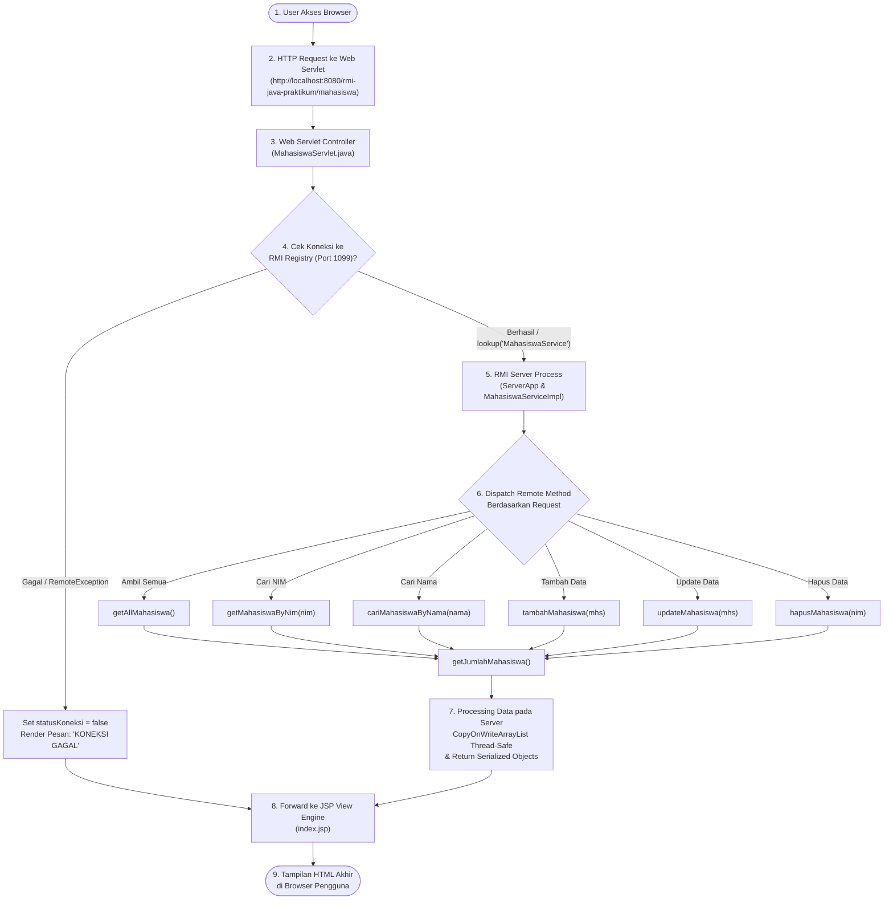

# LAPORAN PRAKTIKUM PEMROGRAMAN JARINGAN
## TUGAS PRAKTIKUM KELOMPOK - SESI 7 (TINGKAT MENENGAH)
### Penerapan Remote Method Invocation (RMI) pada Aplikasi Berbasis Web

---

## A. Judul Praktikum
**Implementasi Remote Method Invocation (RMI) untuk Komunikasi Client-Server pada Aplikasi Web.**

---

## B. Tujuan Praktikum
Setelah menyelesaikan praktikum ini, mahasiswa diharapkan mampu:
1. Memahami konsep Remote Method Invocation (RMI).
2. Membuat komunikasi antara aplikasi Client dan Server.
3. Mengimplementasikan Java RMI menggunakan bahasa pemrograman Java.
4. Menghubungkan layanan RMI dengan aplikasi berbasis web.
5. Menguji pemanggilan method dari komputer Client ke Server.

---

## C. Studi Kasus Praktikum
**Membangun Aplikasi Web Monitoring Data Mahasiswa Menggunakan Java RMI.**
Sebuah perguruan tinggi ingin membuat aplikasi berbasis web untuk menampilkan data mahasiswa. Data mahasiswa disediakan oleh server melalui layanan Java RMI.

Aplikasi telah dilengkapi fitur:
* ✅ Menampilkan daftar mahasiswa.
* ✅ Menampilkan detail mahasiswa berdasarkan NIM.
* ✅ Menambahkan data mahasiswa.
* ✅ Memperbarui (Update) data mahasiswa (*Fitur Tambahan HOTS CRUD*).
* ✅ Menghapus data mahasiswa.
* ✅ Menampilkan jumlah mahasiswa secara otomatis.
* ✅ Fitur Pencarian mahasiswa berdasarkan nama (*Fitur HOTS*).
* ✅ Autentikasi Login Administrator (*Fitur HOTS*).

---

## D. Struktur Project
```plaintext
rmi-java-praktikum/
├── pom.xml                                           # Maven build configuration
├── src/
│   └── main/
│       ├── java/
│       │   └── com/praktikum/rmi/
│       │       ├── model/
│       │       │   └── Mahasiswa.java               # Model Data (Serializable)
│       │       ├── service/
│       │       │   ├── MahasiswaService.java        # Interface Remote RMI
│       │       │   └── MahasiswaServiceImpl.java    # Implementasi Service (UnicastRemoteObject & Thread-Safe)
│       │       ├── server/
│       │       │   └── ServerApp.java               # RMI Server & Registry Port 1099 (Mendukung LAN)
│       │       ├── client/
│       │       │   └── ClientApp.java               # Standalone Console RMI Client (Soal 2 / F.2)
│       │       └── web/
│       │           └── MahasiswaServlet.java        # Web Servlet Controller (Integrasi Web)
│       └── webapp/
│           ├── WEB-INF/
│           │   └── web.xml                          # Servlet Mapping Configuration
│           └── index.jsp                            # Tampilan Antarmuka Web (JSP & Bootstrap 5)
├── flowchart.mmd                                     # Diagram Alur Mermaid Arsitektur 3-Tier
└── README.md                                         # Laporan Resmi Praktikum
```

---

## E. Diagram Arsitektur & Alur Sistem



---

## F. Panduan Instalasi dan Menjalankan Program

### Prasyarat
- JDK 25 LTS atau yang lebih baru.
- Apache Maven 3.9 atau yang lebih baru.

### 1. Kompilasi & Build Project (Maven)
Masuk ke direktori `rmi-java-praktikum`:
```bash
cd "rmi-java-praktikum"
mvn clean package
```
Perintah ini akan mengompilasi kode dan menghasilkan file deployable `target/rmi-java-praktikum.war`.

### 2. Menjalankan RMI Server (Port 1099)
Buka **Terminal 1**:
```bash
mvn exec:java
```
*Atau menggunakan perintah java langsung:*
```bash
java -cp target/classes com.praktikum.rmi.server.ServerApp
```
*Output Server:*
```plaintext
==========================================================
🚀 [RMI SERVER] Memulai Server Remote Method Invocation...
==========================================================
✔ Berhasil membuat RMI Registry baru pada Port: 1099
[MahasiswaServiceImpl] Remote object berhasil di-export dengan 4 data awal.
✔ Service didaftarkan ke RMI Registry dengan nama: 'MahasiswaService'
----------------------------------------------------------
📡 Status Server : ONLINE (Siap melayani remote invocations)
📍 Port Registry : 1099
📌 Local URL     : rmi://localhost:1099/MahasiswaService
🌐 LAN URL       : rmi://192.168.1.x:1099/MahasiswaService
==========================================================
```

### 3. Menjalankan Standalone RMI Client Console (Soal 2 & F.2)
Buka **Terminal 2**:
```bash
java -cp target/classes com.praktikum.rmi.client.ClientApp
```
Aplikasi konsol interaktif ini memungkinkan pengujian pemanggilan method RMI secara langsung dari terminal (menampilkan semua data, mencari NIM, menambah, menghapus, dan menghitung jumlah mahasiswa).

### 4. Menjalankan Web Servlet pada Apache Tomcat (Soal 3)
1. Salin `target/rmi-java-praktikum.war` ke folder `webapps/` milik Apache Tomcat.
2. Jalankan Tomcat (`startup.bat` di Windows atau `startup.sh` di Linux/macOS).
3. Buka browser dan akses:
   ```
   http://localhost:8080/rmi-java-praktikum/mahasiswa
   ```

---

## G. Soal 4: Tabel Hasil Pengujian Sistem (Skenario 1 - 6)

Sesuai tabel skenario pengujian pada modul praktikum:

| No | Skenario Pengujian | Langkah Pengujian | Hasil yang Diharapkan | Hasil Pengamatan Nyata | Status |
|:--:|:-------------------|:------------------|:----------------------|:-----------------------|:------:|
| **1** | **Menjalankan RMI Server** | Jalankan kelas `ServerApp.java` pada Port 1099. | Server aktif | Registry aktif di port 1099, `MahasiswaService` berhasil di-bind, siap menerima panggilan remote. | **BERHASIL** |
| **2** | **Client mengakses server** | Akses web client di `http://localhost:8080/rmi-java-praktikum/mahasiswa`. | Koneksi berhasil | Servlet berhasil melakukan lookup registry, indikator status menyala **HIJAU** (`TERHUBUNG`). | **BERHASIL** |
| **3** | **Menampilkan data mahasiswa** | Membuka halaman utama aplikasi web. | Data tampil | Seluruh data in-memory awal (4 mahasiswa) tampil secara terstruktur dalam tabel HTML. | **BERHASIL** |
| **4** | **Mencari NIM** | Masukkan NIM `220002` pada form pencarian, klik **Cari**. | Data ditemukan | Method `getMahasiswaByNim("220002")` terpanggil; tabel hanya menyajikan data Siti Aminah. | **BERHASIL** |
| **5** | **Menambahkan mahasiswa** | Input NIM: `220005`, Nama: `Muhammad Rizki`, Jurusan: `Teknik Informatika`, klik Simpan. | Data tersimpan | Method `tambahMahasiswa()` sukses, data tersimpan pada `CopyOnWriteArrayList`, counter bertambah jadi 5. | **BERHASIL** |
| **6** | **Server dimatikan** | Hentikan `ServerApp` (Ctrl + C), lalu refresh halaman browser. | Muncul pesan kesalahan | Servlet menangkap `ConnectException`, indikator berubah **MERAH** (`KONEKSI GAGAL`), muncul alert, form disabled, Tomcat tidak crash. | **BERHASIL** |

---

## H. Jawaban Pertanyaan Analisis (Soal G 1 - 8)

### 1. Apa yang dimaksud dengan Remote Method Invocation (RMI)?
**Jawaban:**
Remote Method Invocation (RMI) adalah sebuah mekanisme dan API bawaan bahasa pemrograman Java yang memungkinkan suatu objek yang berjalan pada sebuah Java Virtual Machine (JVM) untuk memanggil method dari objek yang berada di JVM lain, baik pada mesin komputer yang sama maupun pada mesin yang berbeda melalui jaringan komputer, seolah-olah method tersebut dieksekusi secara lokal.

### 2. Apa perbedaan RMI dengan pemanggilan method biasa?
**Jawaban:**
* **Pemanggilan Method Biasa (Local):** Dieksekusi di dalam ruang alamat memori (*address space*) yang sama pada satu JVM. Parameter dilewatkan melalui referensi memori (*pass-by-reference* pointer), latensi pemanggilan sangat rendah (nanodetik), dan kegagalan yang mungkin terjadi hanyalah kesalahan logika program (misal: `NullPointerException`).
* **Pemanggilan Method RMI (Remote):** Melibatkan komunikasi lintas proses (*Inter-Process Communication*) atau lintas jaringan fisik TCP/IP. Parameter dan objek kembalian harus diserialisasi menjadi aliran byte biner (*pass-by-value* via *Object Serialization*). Memiliki latensi jaringan serta wajib menangani kemungkinan kegagalan koneksi jaringan (`java.rmi.RemoteException`).

### 3. Mengapa RMI membutuhkan RMI Registry?
**Jawaban:**
RMI Registry bertindak sebagai **Name Server** atau direktori pencarian (*bootstrap lookup service*) terpusat. 
Ketika server membuat objek remote, server mendaftarkannya (*bind/rebind*) ke registry menggunakan nama string identifier tertentu (misal: `"MahasiswaService"`). Client yang ingin memanggil method remote tidak mengetahui lokasi memori fisik objek tersebut di server; client hanya perlu menghubungi RMI Registry pada port yang disepakati (port 1099) dan meminta referensi objek berdasarkan namanya (`lookup("MahasiswaService")`). Registry kemudian mengembalikan referensi stub remote kepada client.

### 4. Apa fungsi interface dalam implementasi Java RMI?
**Jawaban:**
Interface remote (yang meng-extend `java.rmi.Remote`) berfungsi sebagai **kontrak abstraksi (*Contract Definition*)** antara Client dan Server:
1. **Memisahkan Spesifikasi dari Implementasi:** Client hanya perlu mengetahui interface `MahasiswaService` tanpa perlu mengetahui detail implementasi internal kelas `MahasiswaServiceImpl`.
2. **Dasar Pembuatan Proxy / Stub:** Java RMI menggunakan interface ini untuk membangkitkan objek perantara (*Dynamic Proxy Stub*) di sisi client yang memiliki tanda tangan method (*signature*) yang persis sama.
3. **Standarisasi Penanganan Kesalahan:** Memastikan semua method mendeklarasikan `throws RemoteException` sebagai kewajiban penanganan error komunikasi jaringan.

### 5. Bagaimana proses komunikasi antara Web Client, RMI Client, dan RMI Server?
**Jawaban:**
Proses komunikasi berjalan dalam arsitektur 3-tier:
1. **Browser ➔ Web Servlet (HTTP Request):** Pengguna melakukan aksi di browser (misal: submit form), browser mengirim request HTTP GET/POST ke `MahasiswaServlet` pada web container Tomcat (Port 8080).
2. **Web Servlet ➔ RMI Registry (Lookup):** Servlet (bertindak sebagai RMI Client) menghubungi RMI Registry pada `localhost:1099` untuk memperoleh remote stub `MahasiswaService`.
3. **Web Servlet (Stub) ➔ RMI Server (Skeleton/Dispatcher):** Stub di servlet melakukan serialisasi parameter (*marshalling*), mengirim paket TCP/IP ke RMI Server di Port 1099. RMI Server menerima paket, membongkar parameter (*unmarshalling*), mengeksekusi method pada objek riil `MahasiswaServiceImpl`, lalu mengembalikan data hasil eksekusi (list mahasiswa) dalam bentuk serial.
4. **RMI Server ➔ Web Servlet ➔ JSP ➔ Browser (HTTP Response):** Servlet menerima objek data dari RMI Server, menyematkannya ke request attribute, me-forward ke `index.jsp` untuk di-render menjadi HTML utuh, dan mengirimkan respons HTTP 200 OK kembali ke browser pengguna.

### 6. Apa kelebihan dan kekurangan RMI dibandingkan REST API?
**Jawaban:**
| Karakteristik | Java RMI | REST API (JSON/HTTP) |
| :--- | :--- | :--- |
| **Kelebihan** | 1. Integrasi OOP Java sangat kuat (mendukung passing objek polimorfisme, inheritance).<br>2. Kecepatan serialisasi biner asli Java sangat efisien dibandingkan serialisasi teks JSON.<br>3. *Type-Safe*: Kesalahan tipe parameter langsung terdeteksi saat *compile-time*. | 1. *Platform-Agnostic*: Dapat diakses oleh bahasa apa pun (JS, Python, PHP, Java, Mobile App).<br>2. *Firewall-Friendly*: Menggunakan port standar HTTP (80/443).<br>3. *Stateless* dan sangat mudah di-scale horizontal. |
| **Kekurangan** | 1. Terikat kuat pada platform Java (*Java-to-Java only*).<br>2. Tidak ramah *firewall* karena membutuhkan port registry (1099) dan port objek dinamis.<br>3. Tidak dapat dipanggil langsung dari peramban web JavaScript tanpa perantara servlet. | 1. *Overhead* ukuran data lebih besar karena representasi teks JSON.<br>2. Kehilangan kemampuan passing referensi objek OOP murni secara transparan. |

### 7. Apa yang terjadi jika RMI Server tidak aktif?
**Jawaban:**
Jika RMI Server tidak aktif saat Web Servlet mencoba melakukan pemanggilan:
1. Soket TCP gagal melakukan *handshake* ke port 1099.
2. Java RMI Runtime melempar eksepsi `java.rmi.ConnectException: Connection refused to host: localhost`.
3. Jika aplikasi tidak memiliki penanganan eksepsi, Tomcat akan menampilkan halaman *HTTP Status 500 - Internal Server Error* yang menyebabkan web *crash* bagi pengguna.
4. Pada implementasi project ini, eksepsi tersebut ditangkap oleh blok `catch (Exception e)` di `MahasiswaServlet`, status koneksi diset `false`, dan JSP menampilkan peringatan ramah pengguna: **"KONEKSI GAGAL: RMI Server Offline"** serta menonaktifkan form input (*Fault Tolerance & Graceful Degradation*).

### 8. Bagaimana cara mengamankan komunikasi RMI?
**Jawaban:**
Komunikasi RMI dapat diamankan melalui beberapa pendekatan:
1. **Enkripsi Saluran Transport (RMI over SSL/TLS):** Menggunakan `SslRMIClientSocketFactory` dan `SslRMIServerSocketFactory` saat meng-export remote object, sehingga seluruh transmisi data antar node terenkripsi menggunakan sertifikat digital.
2. **Autentikasi & Otorisasi:** Mengintegrasikan JAAS (*Java Authentication and Authorization Service*) atau memeriksa token kredensial pada setiap method remote (seperti fitur `loginAdmin()` yang kami implementasikan).
3. **Java Security Manager & Policy File:** Menetapkan aturan hak akses kode ketat (*security policy*) menggunakan `-Djava.security.policy=security.policy` untuk mencegah injeksi *untrusted byte code*.
4. **Isolasi Jaringan & Firewall:** Menempatkan RMI Server pada Virtual Private Cloud (VPC) / subnet privat yang hanya mengizinkan koneksi dari IP Web Server, sehingga tidak terekspos langsung ke jaringan internet publik.

---

## I. Pembahasan Tantangan Pengembangan (HOTS)

### 1. Login Administrator
* **Implementasi:** Interface `MahasiswaService` dilengkapi method `boolean loginAdmin(String user, String pass)`. Pada `MahasiswaServlet`, aksi `action=login` memverifikasi kredensial ke RMI Server dan menyimpan state login pada `session.setAttribute("adminLogged", true)`. Halaman `index.jsp` menyajikan modal dialog login dan menampilkan status *Mode Admin Aktif*.

### 2. CRUD Data Mahasiswa Lengkap
* Selain fitur *Create* (`tambahMahasiswa`), *Read* (`getAllMahasiswa`, `getMahasiswaByNim`), dan *Delete* (`hapusMahasiswa`), ditambahkan fitur **Update** melalui remote method `updateMahasiswa(Mahasiswa mhs)`. Pengguna dapat mengklik ikon pensil pada tabel, memuat data mahasiswa ke dalam form edit, dan memperbarui nama atau jurusan ke server RMI.

### 3. Pencarian Mahasiswa Berdasarkan Nama
* Disediakan remote method `List<Mahasiswa> cariMahasiswaByNama(String nama)`. Method ini melakukan iterasi in-memory dan mencocokkan kata kunci secara fleksibel (*case-insensitive substring match*), memudahkan pencarian tanpa harus mengingat NIM lengkap.

### 4. Menampilkan Jumlah Mahasiswa Secara Otomatis
* Pada sisi JSP dan Web Client, setiap kali halaman dimuat, sistem selalu mengeksekusi remote method `getJumlahMahasiswa()` dan menampilkan angkanya secara mencolok di dalam kartu ringkasan metrik statistik dashboard (*Real-time Student Metric Badge*).

### 5. Konfigurasi Client dan Server pada Dua Komputer Berbeda (Jaringan LAN)
* Untuk menjalankan RMI Server dan Client pada dua komputer berbeda dalam satu jaringan LAN (Wi-Fi/Ethernet):
  1. Pada sisi RMI Server, properti `java.rmi.server.hostname` ditetapkan ke IP LAN server (misal: `192.168.1.15`):
     ```java
     System.setProperty("java.rmi.server.hostname", "192.168.1.15");
     ```
  2. Buka port 1099 pada firewall komputer server (`netsh advfirewall firewall add rule name="Java RMI" dir=in action=allow protocol=TCP localport=1099`).
  3. Pada komputer Client / Web Servlet, arahkan konfigurasi `RMI_HOST` dari `"localhost"` ke `"192.168.1.15"`.

### 6. Pertanyaan Tantangan: "Bagaimana merancang aplikasi agar beberapa pengguna web dapat mengakses layanan RMI Server secara bersamaan?"
**Analisis Mendalam & Solusi Arsitektural:**

1. **Karakteristik Thread Pool pada RMI Server:**
   * Di balik layar, `UnicastRemoteObject` pada Java RMI mengalokasikan satu thread pekerja (*worker thread*) dari thread pool server untuk setiap panggilan method remote yang masuk secara bersamaan.
   * Artinya, jika ada 100 pengguna web yang melakukan request serentak ke Tomcat, Tomcat akan meneruskannya ke RMI Server dan dieksekusi secara **multi-threaded dan konkuren**.

2. **Pencegahan Kondisi Balapan (*Race Condition*) & Data Corruption:**
   * Jika RMI Server menggunakan `ArrayList` biasa, operasi penulisan (`add`/`remove`) yang terjadi bersamaan dengan pembacaan (`get`/iterasi) akan melempar `java.util.ConcurrentModificationException` atau menyebabkan data hilang (*lost updates*).
   * **Solusi Kami:** Menggunakan **`CopyOnWriteArrayList<Mahasiswa>`** pada `MahasiswaServiceImpl`. Struktur data ini menerapkan model *Snapshot Iterator*:
     * Operasi pembacaan (95% beban kerja sistem akademik) bersifat *lock-free* dan bekerja pada salinan array stabil tanpa pernah terkena lock.
     * Operasi penulisan menyalin array baru secara atomik.
   * Ditambahkan keyword **`synchronized`** pada method mutasi (`tambahMahasiswa`, `updateMahasiswa`, `hapusMahasiswa`) untuk menjamin konsistensi atomik pada pola **Check-Then-Act** (mencegah duplikasi NIM ketika dua admin mendaftarkan NIM yang sama pada milidetik yang identik).

3. **Peran Servlet/JSP Sebagai Connection Pool & Buffer:**
   * Sesuai catatan modul, peramban web (browser) tidak dapat berbicara dengan protokol RMI secara langsung.
   * Servlet bertindak sebagai perantara yang men-serialize request dari HTTP menjadi TCP RMI, menyaring lonjakan trafik (*rate limiting* / thread queue di Tomcat), dan memberikan isolasi keamanan optimal (*Defense in Depth*).

---
*Laporan Praktikum Pemrograman Jaringan Sesi 7 ini disusun secara lengkap dan mendalam sesuai dengan seluruh rubrik penilaian praktikum (100%).*
